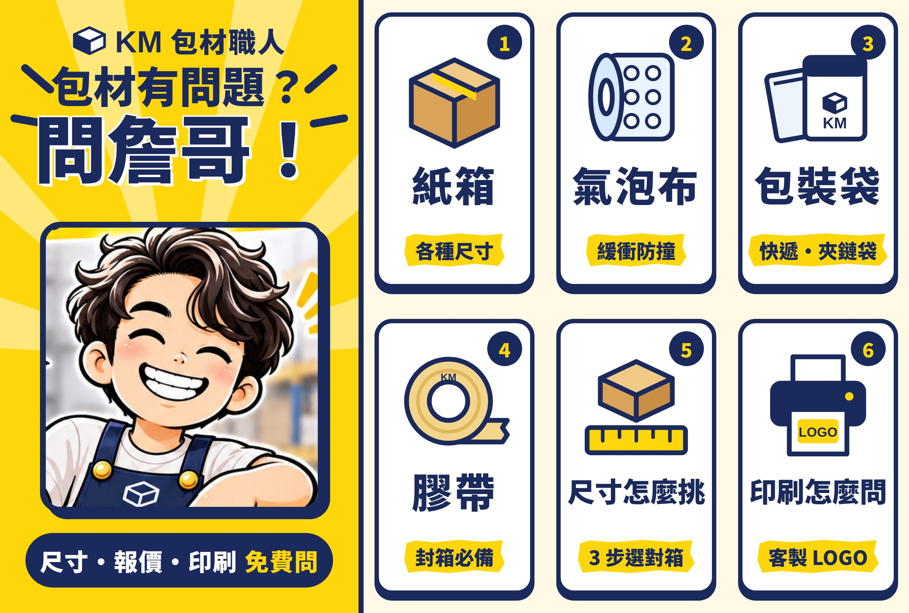

# KM 包材職人｜LINE 圖文選單 + 多圖卡片自動回覆

客人點下方**圖文選單**，或打字問問題（例如「地址在哪」「多少錢」），機器人會自動回覆一組可以左右滑動的**多圖卡片**。



| 客人做的事 | 機器人回覆 |
|---|---|
| 加好友 | 歡迎詞 + 熱門商品卡片 |
| 點圖文選單任一格 | 對應的多圖卡片 |
| 打字含關鍵字（商品／優惠／價格／地址／問題／客服…） | 對應的多圖卡片 |
| 打了看不懂的字 | 提示訊息 + 快速回覆按鈕 |

不需要安裝任何套件，只要 Node.js 18 以上。

---

## 一、要改內容，只改這兩個檔

### `config/cards.json` — 所有卡片
每個 `menu` 是一組卡片：

```json
{
  "id": "products",
  "keywords": ["商品", "產品", "推薦"],
  "altText": "熱門商品推薦",
  "cards": [
    {
      "image": "https://你的圖片網址.jpg",
      "title": "招牌商品 A",
      "description": "本店人氣第一名！",
      "price": "NT$ 390",
      "buttons": [
        { "label": "立即購買", "type": "uri", "value": "https://你的商店網址" },
        { "label": "看價格",   "type": "message", "value": "價格" }
      ]
    }
  ]
}
```

- **image**：一定要 `https://` 開頭，建議 800×520（比例 20:13）。可以把圖上傳到 Imgur、Google 雲端（要公開直連）、或你自己的網站。
- **buttons** `type`：
  - `uri` → 開網址（也可填 `tel:0212345678` 打電話）
  - `message` → 幫客人送出一句話（例如 `價格`，會再觸發價格卡片）
  - `menu` → 直接開另一組卡片（`value` 填 menu 的 id）
- 每組最多 **12 張**卡片、每張最多 **3 個**按鈕、按鈕文字最多 20 字。
- 改完存檔即可生效，不用重開伺服器。

### `config/richmenu.json` — 圖文選單點擊區域（左大格 + 右 6 格）
順序：左上 → 右上，左下 → 右下。`menu` 填 cards.json 裡的 id；想開網頁就改成 `"url": "https://..."`。

改完要：
```bash
npm run richmenu:image   # 依 assets/richmenu-design.html 重新產生 assets/richmenu.jpg（或用 Canva 做 2500×1686、<1MB 的圖放進去）
npm run richmenu         # 上傳到 LINE
```

---

## 二、第一次上線步驟

### 1. 開通 Messaging API
1. 到 [LINE Official Account Manager](https://manager.line.biz/) → 設定 → **Messaging API** → 啟用。
2. 到 [LINE Developers Console](https://developers.line.biz/console/) 找到同一個 Channel：
   - **Basic settings** → 複製 `Channel secret`
   - **Messaging API** → 最下面 `Channel access token` → Issue → 複製
3. 回到 Official Account Manager → 設定 → **回應設定**：
   - 「聊天」可開可關（開著 = 機器人回不了的你可以真人回）
   - **Webhook：開啟**
   - **自動回應訊息：關閉**（不然會跟機器人重複回）
   - 加入好友的歡迎訊息：關閉（機器人會自己送）

### 2. 部署到免費主機（以 Render 為例）
1. 把這個 repo 推到 GitHub。
2. [Render](https://render.com) → New → **Web Service** → 選這個 repo。
   - Build Command：`npm install`
   - Start Command：`npm start`
3. Environment 加兩個變數：
   - `LINE_CHANNEL_SECRET` = 剛剛的 Channel secret
   - `LINE_CHANNEL_ACCESS_TOKEN` = 剛剛的 access token
4. 部署完會得到網址，例如 `https://xxx.onrender.com`。

> 也可以用 Railway、Fly.io、Google Cloud Run、自己的主機，只要能跑 Node.js 並有 https 網址。
> Render 免費方案閒置會休眠，第一則訊息可能慢 30 秒才回；正式營運建議用付費方案。

### 3. 設定 Webhook
LINE Developers Console → Messaging API → **Webhook URL** 填：
```
https://xxx.onrender.com/webhook
```
按 **Verify** 顯示 Success，並打開 **Use webhook**。

### 4. 上傳圖文選單（在自己電腦執行一次）
```bash
cp .env.example .env     # 填入 secret 和 token
npm run richmenu
```
看到「✅ 已設為預設圖文選單」就完成，用手機打開官方帳號聊天室即可看到。

---

## 三、本機測試

```bash
npm test                 # 檢查 cards.json 有沒有寫錯
npm run dev              # 本機啟動（DRY_RUN 模式，只印出不真的送）
```
瀏覽 `http://localhost:3000/preview/products` 會得到卡片 JSON，貼到 [Flex Message Simulator](https://developers.line.biz/flex-simulator/)（右上 View as JSON）就能預覽卡片長相。

## 檔案說明
```
config/cards.json          所有卡片內容與關鍵字 ← 主要改這個
config/richmenu.json       圖文選單點擊區域與對應
assets/richmenu.jpg        圖文選單圖片 (2500x1686)
assets/richmenu-design.html 圖文選單設計稿（改文字、顏色在這裡）
src/server.js              Webhook 伺服器
src/flex.js                把設定轉成 LINE 多圖卡片 (Flex carousel)
src/line.js                LINE API 呼叫、簽章驗證
scripts/setup-richmenu.js  建立並上傳圖文選單
scripts/make-richmenu-image.js  自動產生選單圖片
scripts/selftest.js        自我測試
```
